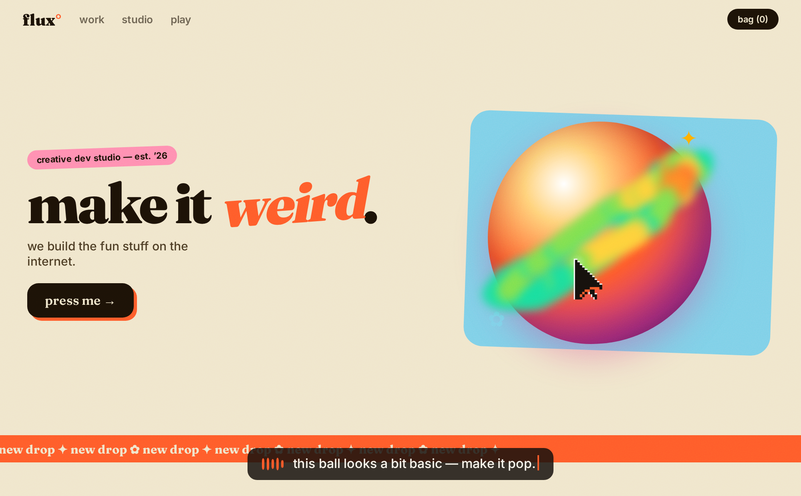

# Disdat is a browser extension for coding agents.

Point and talk while it records the DOM, styles, framework state, motion and runtime events you are looking at.

Local mode uses the original on-device Whisper and WebLLM pipeline. You can also select your own Deepgram and Groq or Anthropic keys. The capture saves as local JSON for your coding agent.



[Website demonstration.](docs/assets/README.md)

## Install with your agent

[Download the extension](https://github.com/latintzar/disdat/releases/latest/download/disdat-extension.zip) · [Website](https://disdat.dev)

Requirements: Python 3.10+ on macOS or Linux, and desktop Chrome or Chromium. Give your agent this checkout and the [setup skill](skills/disdat-setup/SKILL.md).

For local models, prepare a compatible operator-supplied model library as described in [local model setup](docs/local-models.md):

```sh
python3 tools/disdat.py setup --mode local --model-lib /private/path/to/compatible-model.wasm
python3 tools/disdat.py doctor
```

For cloud providers, keep your keys in a private environment and use `python3 tools/disdat.py setup --provider groq`, or select `--provider anthropic`. Keys can also come from `--env-file /private/disdat.env` or hidden local input with `--prompt`. [Configuration](docs/configuration.md) lists the variables and storage locations.

Load the extension directory printed by setup through `chrome://extensions` → Developer mode → Load unpacked. Allow microphone access at the first recording. These browser permissions remain under your control.

## Record and use a capture

1. Open a page, click Dis Dat or press **Alt+Shift+D**, and start recording. Capture follows navigation in that tab; screenshots pause while another tab is active.
2. When **Stop** appears, talk while you point, hover, scroll and move between pages. Stop when you finish.
3. The browser downloads `disdat-capture-*.json`. Paste the copied briefing into your coding agent.
4. The agent unpacks the file and starts with `core.json`:

```sh
python3 tools/disdat.py unpack /path/to/Downloads/disdat-capture-EXAMPLE.json
```

The [capture skill](skills/disdat/SKILL.md) explains the artifact format and how to work from captured facts. The core includes the transcript and engaged elements; the other artifacts hold captured DOM, screenshots, assets and sources. Capture files can contain private page content, so keep them with the project they belong to.

## Runtime modes

| Mode | Transcription and briefing | Artifact delivery |
|---|---|---|
| Local | On-device Whisper and WebLLM, with model weights downloaded on first use | Local browser download |
| Own keys | Direct Deepgram plus your selected Groq or Anthropic account | Local browser download |
| Hosted | Existing Dis Dat sign-in and hosted provider proxy | Existing hosted artifact workflow |

Choose the existing hosted path explicitly with `python3 tools/disdat.py setup --mode hosted`. Provider usage follows the selected account's terms and billing. [Local model setup](docs/local-models.md) covers its binary and hardware requirements. [Architecture](docs/architecture.md) explains the data flow; [extraction decisions](docs/decisions.md) explain the tradeoffs.

## Other tools

- [Token MCP](mcp/README.md): let an agent query a local token library, export CSS/DTCG or use the existing optional Figma path.
- [Website source](website/README.md): the Dis Dat home page, download page and product demonstrations.
- [Extension packaging](docs/extension-download.md): reproduce the exact unconfigured download from reviewed source files.
- [Release status](RELEASE-STATUS.md): included source, validation and remaining work.
- [Provenance](PROVENANCE.json): exact original source commit and copied files.
- [Export scope](docs/export-scope.md): retained source and historical experiments preserved privately.

Original code is [MIT licensed](LICENSE). Fonts and dependencies retain their [own licences and notices](THIRD-PARTY-NOTICES.md).
